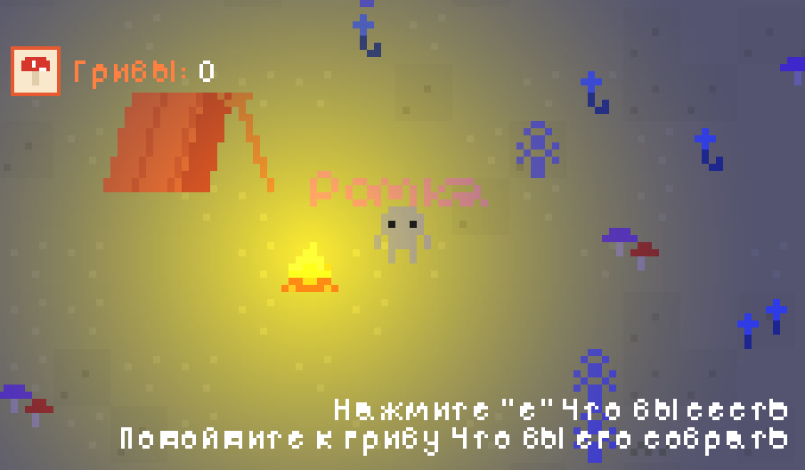

# 02_Forest_Explorer

> **Дата:** 30.10.2026
> **Автор (ФИО):** Фамилия Имя Отчество

---

## Описание проекта
2D-игра в Godot: персонаж-исследователь гуляет по ночному лесу, садится у анимированного костра (клавиша E), собирает грибы, а счётчик собранных грибов отображается в интерфейсе. На старте игрок вводит имя, оно показывается над персонажем. Через проход в верхней части леса можно перейти на другую сцену (пещеру) и вернуться обратно.

## Стек проекта
* **Игровой движок / Платформа:** Godot Engine 4.3+ (Compatibility)
* **Язык программирования:** GDScript
* **Дополнительные инструменты:** Git, Python/Pillow (генерация пиксель-арта), шрифт Pixelify Sans (SIL OFL)

## Что было использовано в проекте
* **Узлы (Nodes):** TileMapLayer, CharacterBody2D, CollisionShape2D, Camera2D, AnimatedSprite2D, Area2D, Sprite2D, CanvasLayer, MarginContainer, HBoxContainer, TextureRect, Label, LineEdit, Button, CanvasModulate, PointLight2D
* **Паттерны / Подходы:** Глобальный код (Global.gd), Сигналы (Signals), экспорт переменных, инстанцирование сцен
* **Ресурсы:** Кастомные спрайты 8x8 (игрок, костёр, грибы, палатка, сосны), TileSet, текстура света, пиксельный шрифт

## Самостоятельные работы
* **Имя игрока**: Да
* **Переход на другую сцену**: Да

## Управление
* WASD / стрелки - движение
* E - сесть / встать
* Esc - выход
